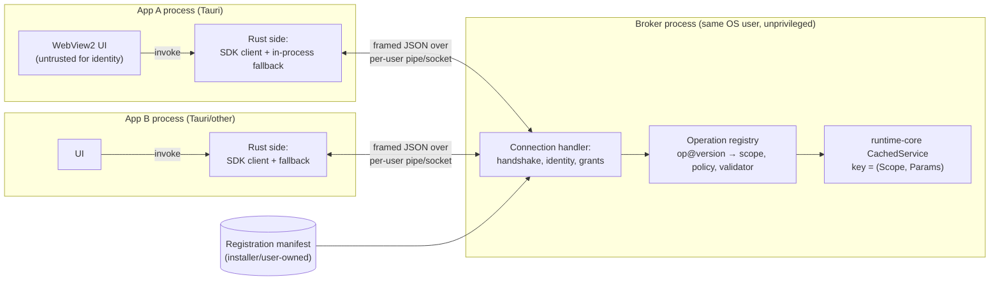
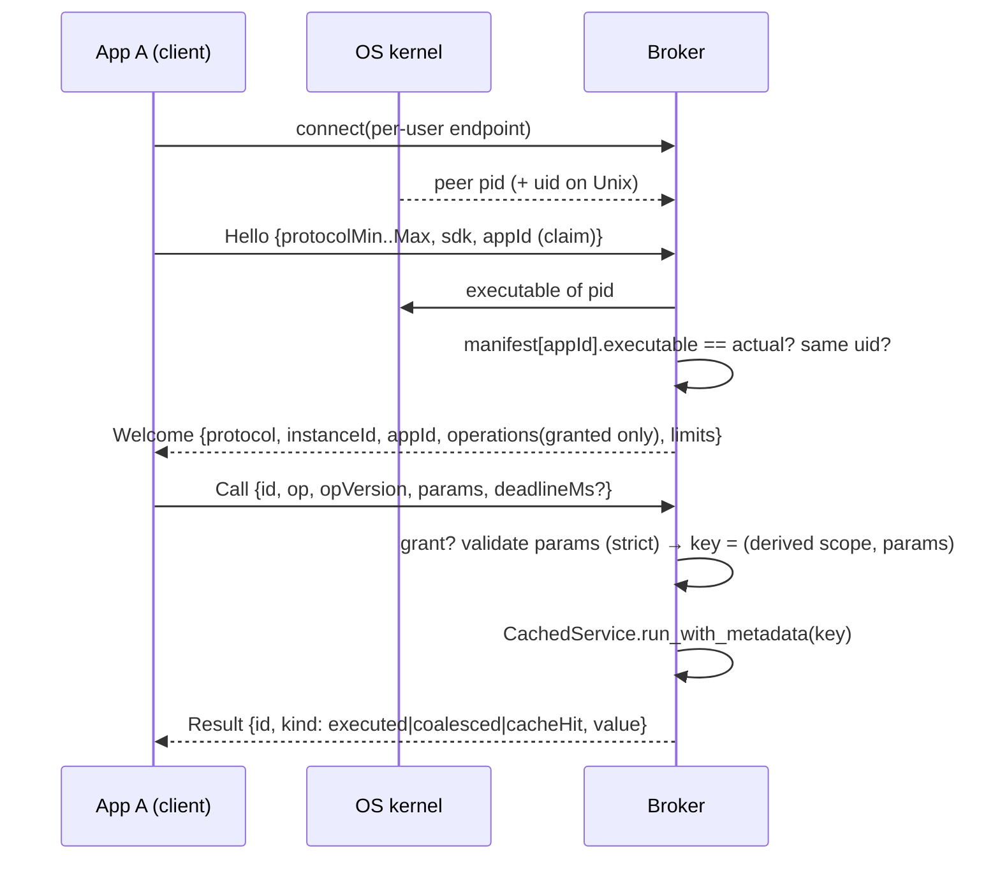

# 02. ADR (proposed): a shared service for independently launched applications

**Status: proposed, for Group 1 review. Not accepted.** It records what Group 2 recommends and why. The decisions it depends on are listed in [06 §3](06-implementation-plan.md#3-questions-that-block-group-1). Until Group 1 accepts it, the project boundary in `AGENTS.md` (#26) stands: the product runtime is in-process.

## 1. Context

- Today `runtime-core` (`CachedService` = `PolicyCache` + `TaskCoalescer` + generations) lives **inside** one Tauri process and serves that process's WebView windows. The Core semantics V1–V4/G6 are pinned by tests in #12/#14.
- Stage 4 measurements (Windows 10, Release, 2 windows, PR #11 comments) put the Rust process at ~25 MB WS / ~8–9 MB Private. The remaining ~95 % of an app's memory is WebView2 (browser, GPU and renderer processes).
- Ваня's north star (#13, 6402306556) asks for a design that reduces *duplicated memory work across independently running applications*. It requires an ADR before any cross-app code. It must not merge or inject into browser processes, and only allowlisted, deterministic, non-sensitive data may be shared.

**Consequence for the goal.** A shared service can only save memory that each application would otherwise duplicate *outside* Chromium/V8: working buffers, caches, indexes and decoded datasets held by the Rust side. It cannot reduce WebView2 memory. If an application must hold the full result in its own process anyway, sharing saves only the transient working memory and the duplicated cache. The methodology in [05](05-memory-methodology.md) is built around this split.

## 2. Requirements

| # | Requirement | Source |
|---|---|---|
| R1 | Applications launched independently of each other, and of the service, can use it | task §2 |
| R2 | Typed, versioned interface; mismatches fail explicitly | task §2, #15 F5 |
| R3 | Identity and rights come from the OS/runtime, never from a JS value, window label or bare PID | task §2, standing rules |
| R4 | No cross-scope result through cache, coalescer or events. No stale result after invalidation, cancellation or restart | standing rules, V1–V4 |
| R5 | Errors are never cached or handed to a later caller | Core contract |
| R6 | A crash of the service never takes an application down; apps can degrade to in-process | task §2 |
| R7 | No network listener, no privileged daemon, no own crypto, no plugin platform | standing rules |
| R8 | Memory benefit is measured, including the service's own overhead and copy costs | task §4 |
| R9 | Windows first (10 and 11), with no needless dependencies | standing rules |

## 3. Options

| | Option | Sharing across apps | Isolation / security | Lifecycle | Cost | Verdict |
|---|---|---|---|---|---|---|
| **O1** | Core as a library in every app (status quo) | none | best: no new boundary | trivial | 0 | **Baseline and fallback** |
| **O2** | Per-user, unprivileged broker process with local IPC (named pipe / Unix socket), started on demand, idle exit | yes: cache, coalescing, working memory | new boundary, but OS-enforced per user; no network | broker can crash: needs reconnect/fallback | one extra process (≥ few MB) + copy per call | **Recommended** |
| O3 | First app hosts the service in-process, others connect (leader election) | yes | the host app sees every other app's requests and runs with its UI's attack surface (WebView XSS ⇒ broker compromise) | the service dies when the host's user closes its window; handover is complex | none extra | rejected: confused-deputy host, fragile lifetime |
| O4 | Shared memory (read-only mapped sections) for large immutable datasets | yes, zero-copy | every process that maps it reads all of it; corruption/ABI hazards; `unsafe` | needs a writer (= O2 anyway) | lowest per-client copy | **later optimisation inside O2**, only for Public data |
| O5 | System service (Windows Service / launchd / systemd system unit) | yes | privileged; crosses users; installer + elevation | OS-managed | high | rejected: violates R7, cross-user |
| O6 | Share WebView2 browser processes (common user-data folder) or inject into other apps | — | shares cookies, storage and sessions between apps | — | — | **rejected**: a security break, and not what the goal asks |
| O7 | Localhost TCP/HTTP server | yes | reachable by any local process and by web pages (DNS rebinding); needs own auth | as O2 | as O2 | rejected: R7 (network) |

### Why O2

- It is the only option that shares memory across apps without a privileged component or a network listener (R1, R7).
- The OS gives a real per-user boundary: a pipe/socket ACL, kernel-reported peer pid/uid, and no remote clients.
- `runtime-core` can be reused **unchanged**. The scope becomes part of the key type, so the existing V1–V4 guarantees carry over per scope (R4, R5). The spike does exactly this.
- It degrades cleanly to O1. Every shared operation must also be runnable in-process, so the same binary works without the broker (R6). That is also the plain arm of the measurement.
- O4 can be added later behind the same API for large Public datasets, once measurements show that the copy cost dominates.

### What O2 costs, stated up front

- One more process per user session: its baseline RSS/Private, and its own tokio runtime.
- One serialisation and one copy per call (two, if the client converts to its own types). For large results this can cancel the saving ([05 §2](05-memory-methodology.md#2-model-and-break-even)).
- A new attack surface. It is narrowed by the rules in [03](03-threat-model.md), but not removed.
- Operational complexity: on-demand start, single instance, idle exit, crash recovery, version skew.

If the measured break-even never arrives for realistic data, **choose O1** and stop (Ваня's standing rule: drop the shared runtime if it is not worth it).

## 4. Components

- **The WebView never talks to the broker.** It keeps using its own app's Tauri commands. The app's Rust side is the broker client. So window labels and JS arguments never reach the broker's authorisation logic, and the existing Tauri capabilities and IPC contracts stay unchanged.
- **The registry is code, not configuration.** Each operation's name, version, scope kind, cache policy and validator are compiled into the broker. The manifest only maps applications to executables and grants.

## 5. Interaction

## 6. Lifecycle

| Event | Behaviour (implemented in the spike unless marked) |
|---|---|
| First client, no broker | The SDK connects; on `BrokerUnavailable` it starts the broker from a **fixed install path** (never `PATH`), then retries with backoff. *Spawn-on-demand is not in the spike; tests start the broker. Single instance and idle exit are.* |
| Two brokers start at once | Exactly one owns the endpoint. Windows: `FILE_FLAG_FIRST_PIPE_INSTANCE`. Unix: an exclusive lock file held for the process lifetime (released by the kernel on crash). The loser exits with code 3 |
| No clients for `idle` | The broker exits. The next client starts a new instance |
| Client cancels | `Cancel{id}` aborts that client's task; the client drops any late reply. The coalescer re-runs for remaining waiters (Core V3) |
| Client disconnects / is killed | All its calls are aborted; nothing is sent to anyone else |
| Broker crashes | All in-flight calls fail with `BrokerUnavailable` (retryable). `Session` reconnects and retries, which is valid only because shared operations are deterministic and idempotent. A new `instanceId` proves the result came from the new instance; no state survives the restart |
| Version skew | Ranges negotiated in `Hello`/`Welcome`; no overlap ⇒ `Reject{versionMismatch}` and the app uses its fallback. Operations carry their own version (`op@v`); a broker serves v and v−1 during migrations |
| Broker overloaded | Per-connection `maxInFlight` ⇒ `Busy` (retryable); 1 MiB frame limit checked before allocation; deadline capped by the broker |

## 7. Caching, coalescing, invalidation

- **Key = `(Scope, Params)`.** `Scope` is `Public` or `App(verified appId)`, derived from the registry and the verified identity. `Params` is the operation's typed, `deny_unknown_fields` struct, so equal keys mean equal semantic requests; there are no string keys to canonicalise.
- Policy per operation (`NoStore` / `Ttl` / `Forever`). TTL counts from insertion (V4).
- Errors are never cached; a later call re-executes (V1, tested across processes).
- Invalidation is scope-local: a client can only invalidate keys in a scope it can read, and only with an explicit `invalidate:` grant. Public invalidation by one app affects everyone, so it is an admin-class grant ([03](03-threat-model.md) T-9).
- Notices are data-free hints (`op`, `opVersion`, `scope`), delivered only to connections that can read that scope and hold the operation grant. On a notice, clients re-request.
- Results never cross broker instances. No persistent cache in this proposal (it would need its own integrity and versioning rules).

## 8. Failure handling summary

Every client-visible failure has a code ([04 §5](04-api-spec.md#5-error-codes)). The retryable ones are `Busy`, `Timeout` and `BrokerUnavailable`. Everything else is a definite answer that must not be retried unchanged. An app must stay usable without the broker: either in-process fallback, or an explicit "service unavailable" state. Which of the two is used is an application decision, recorded per operation (Q7).

## 9. Consequences

- (+) Shared work and cache across apps, and V1–V4 reused per scope with tests.
- (+) No change to the existing Tauri IPC/capabilities: the broker sits behind the app's Rust side.
- (−) Same-user malware can impersonate a client (see [03 §4](03-threat-model.md#4-residual-risk)). Hence **only data that is acceptable to reveal to any process of the same OS user may enter the broker**.
- (−) Extra process and copies. Benefit is unproven until measured ([05](05-memory-methodology.md)).
