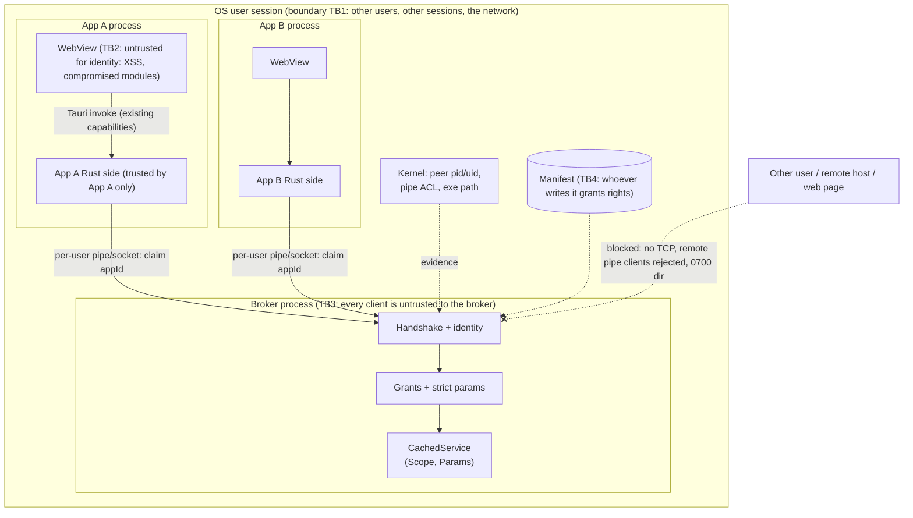

# 03. Threat model, trust boundaries and mitigations

Scope: the O2 broker from [02](02-architecture-adr.md). This builds on the Stage 5 report (#15) and the Stage 10 memo v2. Labels: **[spike]** means implemented and tested in `experiments/cross-app-spike`. **[design]** means specified but not implemented. **[open]** means a Group 1 decision is needed.

## 1. Assets

| Asset | Why it matters |
|---|---|
| A1. Results in the broker cache and in flight | A wrong-scope result is a leak or a poisoning |
| A2. The integrity of results | Clients trust them as if they had computed them themselves |
| A3. Grants and the registration manifest | Whoever can edit them decides who may call what |
| A4. Broker availability | Every client depends on it (mitigated by the fallback) |
| A5. Metadata: which app asks for what, and when | A side channel between applications |

## 2. Trust boundaries and data flow

Data flows: (1) Hello carries only a *claim*. (2) The broker gathers OS evidence and compares it with the manifest. (3) Call params pass strict typed validation. (4) The scope is derived and the key built. (5) The result goes back only on the requesting connection. (6) Notices carry no data and are scope-filtered.

## 3. Threats and mitigations

| # | Threat (STRIDE) | Attack | Mitigation | Status |
|---|---|---|---|---|
| T-1 | Spoofing | A client claims another app's `appId` | The claim is checked against the executable the kernel reports for the peer pid, which must equal the manifest's registered executable (Linux `/proc/<pid>/exe`, Windows `QueryFullProcessImageNameW`). Test: the beta binary claiming alpha ⇒ `identityMismatch` | **[spike]** |
| T-2 | Spoofing | A bare PID is reused, or a socket is passed to another process after `connect` | Same-user check on both sides: uid (Unix), token SID of the peer process (Windows). An exe check alone does **not** stop a same-user process from forking and passing the fd. Hardening: verify on every request? pidfd? Process-start-time binding? Signed binaries? | **[open] Q1** |
| T-3 | Spoofing | Endpoint squatting: a fake broker answers first | The Windows pipe namespace is shared by all users, so the name protects nothing. Windows: `FIRST_PIPE_INSTANCE` (squatter ⇒ real broker refuses to start), the client refuses a broker whose process does not run as the current user (`GetNamedPipeServerProcessId` → token SID), and the pipe DACL admits only the current user. Unix: 0700 dir owned by the user, lock file, and the client checks the server uid. A squatter can still deny service | same-user checks, DACL, dir/lock **[spike]**; server-exe check **[design]**; squatting DoS **[residual]** |
| T-4 | Information disclosure | Cross-scope result via cache (`CacheHit`) | Scope is part of the key type and derived only by the broker | **[spike]** test `app_scope_is_never_shared…` |
| T-5 | Information disclosure | Cross-scope result via coalescing (`Coalesced`) | Same key rule; concurrent alpha/beta with equal params ⇒ two executions, 0 coalesced | **[spike]** |
| T-6 | Tampering / elevation | A client sends `scope`, `isPublic`, `appId` or extra fields inside a call | `deny_unknown_fields` on every message and every params type; the scope is never read from input | **[spike]** (unit + cross-process test) |
| T-7 | Information disclosure | Event leak: a notice reveals another app's activity or data | Notices carry no params/values, go only to the same scope and only with the op grant; no broadcast | **[spike]** test `notices_reach_only…` |
| T-8 | Tampering | Stale result after invalidation, cancellation or restart | Core V1–V4 (generations, no repopulation); a cancelled call's reply is dropped client-side; results never cross `instanceId` | **[spike]** (cancel, restart tests) + Core tests #12/#14 |
| T-9 | Denial of service | Cache-busting: one app invalidates Public keys repeatedly | `invalidate:` is a separate grant; Public invalidation should be admin-only | grant **[spike]**; who holds it **[open] Q4** |
| T-10 | Denial of service | Floods: huge frames, many calls, slow-loris Hello, connections that fail during accept | 1 MiB frame cap checked before allocation; `maxInFlight`; Hello timeout; deadline cap; strict param bounds; a failed accept is logged and skipped, never fatal (test `a_failed_accept_does_not_stop_the_broker`) | **[spike]**; connection count limit, per-app quotas and memory caps **[design]** |
| T-11 | Tampering | Poisoning: a client supplies a "result" for others | Clients never write results; only broker-side registered code computes them | **[spike]** by construction |
| T-12 | Elevation | The broker runs as admin/SYSTEM, or is started from `PATH` | Unprivileged, same user; launched from a fixed install path | **[design]** |
| T-13 | Information disclosure | Stats/metadata side channel (A5) | `stats` is a grant; per-op counters are global, so they are admin-only | **[spike]**; final policy **[open] Q4** |
| T-14 | Tampering | Manifest edited by a same-user process | The manifest is as strong as its file ACL. Options: per-machine read-only install location, signed manifest, OS app identity (MSIX package family) | **[open] Q2** |
| T-15 | Repudiation | No record of who invalidated what | Audit log of admin actions (appId, op, time) | **[design]** |
| T-16 | DoS / integrity | An operation panics; with `panic = "abort"` the broker dies for everyone | Recovery = crash + reconnect (tested). Alternatively a separate broker profile without abort, or `catch_unwind` per operation (В5 forbade it for Core stage 1) | **[open] Q6** |
| T-17 | Information disclosure | Sensitive data enters a Public op | Only registered, deterministic operations over non-sensitive inputs. Data classification is reviewed per operation; credentials/cookies/tokens/accounts/sessions/user-private data are excluded | **[open] Q3** (policy owner) |
| T-18 | Version confusion | Old SDK + new broker silently misread fields | Range negotiation, `op@version`, strict decoding ⇒ explicit `versionMismatch`/`unknownOperation` | **[spike]** |

## 4. Residual risk

The broker cannot defend against **malicious code running as the same OS user**. On desktop Windows/Linux such code can usually debug or inject into the registered binary, read its memory, or reuse its connection. Therefore:

1. Data allowed into the shared broker must be **acceptable to disclose to any process of the same user** (Public), or at most to "the same application" against honest-but-buggy peers (App). App scope is a correctness boundary between cooperating apps, not a defence against hostile same-user code.
2. User-private, account, session and credential data stays in each application's own process (O1). It never goes through the broker.
3. Cross-*user* isolation is the real security boundary, and it is OS-enforced (pipe/socket ACL, uid/SID check on both sides, no remote clients). Until 2026-10-26 the Windows spike relied on the default pipe DACL (which also grants Everyone read access) and checked neither side's user; see [07](07-verification-report.md) §6.

These statements are the core of Q3; Group 1 should accept or reject them explicitly.

## 5. Security acceptance tests (proposal)

Every item must be an automated test with real separate processes unless noted. ✓ means it already exists in the spike.

- ✓ A claimed appId with the wrong executable ⇒ rejected; an unregistered appId ⇒ rejected; version mismatch ⇒ rejected.
- ✓ Same op and params, two apps, App scope: 2 executions, 0 coalesced, 0 cache hits across apps (concurrent and sequential).
- ✓ Smuggled fields rejected, nothing executes; unknown op or version rejected.
- ✓ Errors not cached across processes; cancellation delivers nothing and caches nothing; the initiator's cancel does not strand another app.
- ✓ Notices: no data, scope-filtered.
- ✓ Broker crash ⇒ new instance, no stale state; single instance per endpoint.
- ✓ A connection that fails during accept does not stop the broker.
- ◐ Cross-user connection refused: DACL plus server-side SID/uid check are in place; the end-to-end refusal needs a second OS account (manual on Windows).
- ◐ Fake-broker squatting: the client refuses a broker of another user (Windows SID, Unix uid). Not testable without a second account; the SID helper is unit-tested against PID 4. Server-exe check still open.
- ☐ Fork/fd-passing impersonation documented as residual, or blocked once Q1 is decided.
- ☐ Fuzzing of the frame decoder and params (cargo-fuzz, outside CI).
