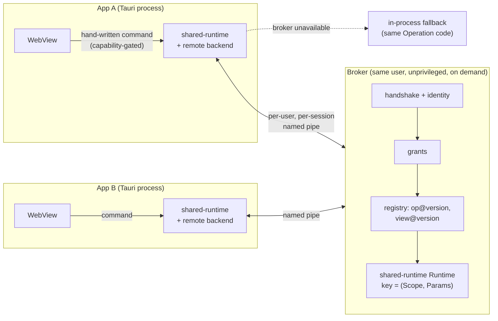

# Cross-app sharing: design for the next stage (proposal)

**Status: proposal for Group 1 review. Nothing here is decided, and no code changes with it.** This answers item 6 of the consolidated task in #54 (comment 6804722250): a design for sharing between applications after the Windows preview. Review comes first. A limited prototype follows only after the review (§12).

| | |
|---|---|
| Base | `main` @ `7244a5c` (the `0.1.0-preview.1` release candidate). The product is the in-process runtime: `runtime-core`, `shared-runtime` and `shared-runtime-tauri`. |
| Builds on | The cross-app package of 2026-10-25: Draft #27 (`docs/cross-app/01–07`, `experiments/cross-app-spike`) and Draft #29 (spike hardening: owner-only pipe DACL, SID checks, accept loop). Neither is merged. Their questions Q0–Q9 are still open. |
| Does not change | Any public API, IPC command, DTO, error code, capability, the TypeScript SDK, the benchmark protocol or a frozen runner. §11 lists the API changes the design would need, so that each one can be agreed separately. |
| Product claims | None. The preview claims only that two windows of one app use one catalog load. A cross-app saving can be claimed only after the measurement in §13. |

## 1. What may be shared, and what may not

**Shared:** data and work owned by Rust. That means results of registered, deterministic operations, their caches, and the work of computing them, for applications that run as the same OS user in the same logon session.

**Never shared:**

- WebView2 / Chromium processes, their user-data folders, cookies, storage or sessions. Each application keeps its own browser processes. Sharing them would break app isolation and is not the goal.
- Credentials, tokens, account data, session data or other user-private data. These stay in each application's own process (the in-process runtime).
- Anything across OS users or logon sessions.
- Anything over a network. There is no TCP or HTTP listener.

**Not provided:** a privileged service, own cryptography, a plugin platform, or code loaded at run time. The broker runs only operations compiled into it.

The memory that sharing can save is the Rust-owned part of each application: decoded datasets, indexes, caches and working buffers. WebView memory does not change. Whether the saving exceeds the broker's own cost is the open question (§13). If it does not, the project stays in-process. That is the standing rule.

## 2. Architecture in one picture



This is option O2 from the October ADR (#27, `02-architecture-adr.md`): a per-user broker process on a local pipe. Two things change from the spike:

1. **The broker hosts a `shared-runtime` `Runtime`, not a bare `CachedService`.** Budgets, deadlines, overload, shutdown and views then work as they do in-process, and they are already tested there.
2. **Views run in the broker.** A client gets a bounded page or aggregate, not the whole output. This is what makes sharing pay: in the break-even model of `docs/cross-app/05-memory-methodology.md` (#27), the retained copy `T` per client must be much smaller than the dataset `D`. If a client copied the whole output, the saving per extra client would shrink to transient working memory only.

The WebView never talks to the broker. It calls the application's own commands, as it does now. The broker never sees a window label or a value from JavaScript.

## 3. Contract for immutable resources

A *resource* is one operation output held by the broker.

| # | Rule | Why |
|---|---|---|
| I-1 | A resource is identified by `(scope, op name, op version, params)`. `scope` is `Public` or `App(verified appId)`. The broker derives the scope from the registry and the verified identity, never from a message. | No scope field can be forged. Equal keys mean equal semantic requests (typed `deny_unknown_fields` params). |
| I-2 | Once published, a resource never changes. Nothing ever mutates it in place, and clients never write results. | A reader can never see a half-updated value. A client cannot poison what others read. |
| I-3 | Only registered operations produce resources. Their output must be a deterministic function of `(params, op version)` and of inputs that every reader in that scope may see. Time, network, user, account and session inputs are not admitted. | Coalescing and caching across apps are correct only for deterministic outputs. Retry after a broker crash relies on it too (§8). |
| I-4 | A change of params, output shape or semantics is a new op version. Versions never share cache entries. The broker serves `v` and `v−1` for one release. | No silent misread between an old client and a new broker. |
| I-5 | Invalidation never changes a resource. It retires the current generation. Readers already holding the old `Arc` finish with it. New calls get a new execution. In-flight work started before the invalidation cannot repopulate the cache (core V2). | This keeps the existing core semantics across processes. |
| I-6 | Errors are never resources. They are not cached and not handed to a later caller (core V1). | Same as in-process. |
| I-7 | A resource's size is the operation's `weight`, charged to a budget before the resource is kept (§5). A result over its operation's budget is returned to its callers but not kept. | The cache stays bounded by configuration. |
| I-8 | A resource does not outlive its broker instance. There is no persistent cache and nothing is written to disk. Each `welcome` carries an `instanceId`, so a client can tell that a result came from a new instance. | No integrity or versioning problem for stored data. Cleanup after a crash is trivial (§8). |
| I-9 | Integrity comes from construction, not from hashes. Only broker code computes a resource and only the broker holds it. A content hash would be needed only for a shared-memory transport (O4), which is out of scope (§14 Q9). | No own crypto. |

States of a resource:

```text
absent ─call─▶ building ─ok─▶ ready ─invalidate / TTL / evict─▶ retired ─last reader done─▶ freed
                  │                                                          ▲
                  └─error / all callers cancelled─▶ absent (nothing kept) ───┘
```

`building` is shared by coalescing. The rules for cancellation and for the last waiter leaving are the core's B3: one remaining caller restarts the execution.

## 4. Isolation

### 4.1 Between OS users and logon sessions (security boundary)

| Mechanism | Detail | Status |
|---|---|---|
| One broker per user and logon session | The pipe name includes the user SID and the session id: `\\.\pipe\tmwr-<sid>-<session>`. The pipe namespace is shared by every user, so the name alone protects nothing. | SID in the name: #29. Session id: **new**. Today the same user in two sessions (console plus RDP) would share one broker, and logging off one session would end the other's broker. |
| Owner-only DACL | The pipe's DACL allows only the current user (#29 replaced the default DACL, which also lets Everyone read). | #29 |
| Remote clients refused | `PIPE_REJECT_REMOTE_CLIENTS`. | spike |
| Peer user and session checked by the broker | Broker: the token SID of the client process equals its own, and `ProcessIdToSessionId(client)` equals its own session. | SID: #29. Session: **new**. |
| Server checked by the client | The client compares the SID and executable path of `GetNamedPipeServerProcessId` with the expected broker, so a squatter running as the same user is detected. | **new** (threat T-3 in #27) |
| Single instance | `FILE_FLAG_FIRST_PIPE_INSTANCE`. A second broker on the same endpoint fails loudly and exits. | spike |

### 4.2 Between applications (correctness boundary)

- `App` scope keys include the verified `appId`. Two applications never share an `App` result through the cache, the coalescer or a notice. This is spike tests `app_scope_is_never_shared_between_applications` and `notices_reach_only_clients_that_can_read_the_scope`.
- `Public` resources are shared by every granted application. Only data acceptable to disclose to any process of the same user may be `Public`.
- **Residual risk, stated plainly:** the broker cannot defend against hostile code running as the same user. Such code can debug or inject into a registered executable. So `App` scope separates honest but buggy applications. It does not separate hostile ones. This is why private data stays out of the broker (§1). Group 1 should accept or reject this explicitly (Q3).

### 4.3 Between windows

There is no change. Windows exist only inside an application. `PerWindow` operations never go to the broker (§11, A-5). The adapter still builds `Caller` only from the window Tauri injects.

## 5. Permissions

| Item | Rule |
|---|---|
| Who the client is | The client claims an `appId` in `hello`. The broker accepts the claim only if OS evidence matches the registration: the executable path of the peer process (`GetNamedPipeClientProcessId` → `OpenProcess` → `QueryFullProcessImageNameW`), the same SID and the same session. The broker holds the process handle for the whole connection, so the PID cannot be reused while it is held. The PID-to-handle race is closed by checking that the process creation time precedes the connection. This choice is still Q1. |
| Registration | A manifest maps `appId` → executable path → grants. Q2 recommends a per-machine read-only location written by the installer, with a per-user override for development builds behind a flag. |
| Grants | `call:op@v`, `view:view@v`, `invalidate:op@v`, `stats`. `welcome` lists only the operations this client is granted, so the catalogue itself discloses nothing. |
| Public invalidation and stats | Admin-class grants (Q4). One application must not be able to evict every other application's `Public` data or watch their activity. |
| WebView access | Unchanged: Tauri capabilities decide which window may run which command. The broker knows nothing about windows. |

## 6. Memory limits

All limits are set by configuration, have no defaults (as `RuntimeConfig` has none), and are validated at start-up. The values that end up in use come from measurement, not from this document.

| Limit | Bounds | Refusal |
|---|---|---|
| `cache_budget_bytes` of the broker runtime, split into reserved per-operation budgets | retained resources (I-7) | not kept, LRU eviction (existing) |
| Per-app quota for `App` scope: the summed weight of one application's `App` resources | one application filling the cache with its private keys | LRU within that app's quota; other apps unaffected. **New in `shared-runtime`** (§11, A-6). |
| `max_concurrent_operations`, `max_queued_operations`, `max_concurrent_projections` | executions and responses in flight | `Overloaded` (existing) |
| `max_connections` | broker per-connection state | `reject: busy` at handshake. **New.** |
| `max_in_flight` per connection | pending calls of one client | `busy` (spike) |
| Frame size, both directions, checked before allocation | wire buffers | `frameTooLarge`, connection closed (spike: 1 MiB) |
| View `max_items`, `max_response_bytes`, `ResponseBudget` | response size, as in-process | `RESPONSE_TOO_LARGE` (existing) |
| Response bytes accepted by the client before forwarding to the WebView | client memory | the adapter's existing serialized-size check |

The broker's own memory is the cost side of the saving. It is reported, never hidden: idle broker, broker under load, and per-connection overhead (`B0` and `c` in the model).

## 7. Client disconnect and cleanup

**When a client disconnects or is killed:**

1. The broker cancels that connection's calls. Waiters from other clients keep the execution, and if the leaving client was running it, a remaining waiter restarts it (B3).
2. No reply for that connection is sent or buffered.
3. Per-connection state is freed: the call table, the subscriptions and the held process handle.
4. Shared resources are not touched. They belong to the scope, not to the connection. An `App` resource is kept until TTL, eviction or invalidation, even if its app has no connection left, so a reconnect finds it.
5. A client that hangs without disconnecting is bounded by `max_in_flight`, the deadline cap and the per-app quota. Idle connections hold no executions.

**Cleanup:**

| What | When |
|---|---|
| Expired entries | TTL from insertion (core V4), swept as today |
| `v−2` op versions | removed from the registry in the next broker release |
| Unused `App` resources | evicted by the per-app quota and LRU. The broker has no notion of an app being uninstalled, so it does not try. |
| The broker itself | exits after `idle_exit` with no connections (spike). The next client starts a new one. |
| Files | none: no cache files and no temp files. The pipe disappears with the process. On Linux, the socket and lock file sit in a `0700` runtime directory. |

## 8. Crash recovery

| Failure | Behaviour |
|---|---|
| Broker crashes (including a panic, since `panic = "abort"` stays) | Every call in flight fails on the client with `brokerUnavailable`. The client then either retries once on a new instance (only for operations marked idempotent, which I-3 requires anyway) or runs the call in-process. Either way the WebView gets an answer, never a hang. |
| Broker restarts | It starts empty. No state survives (I-8). A new `instanceId` is visible to clients. |
| Broker crash loop | Circuit breaker in the client: after `k` failures within window `w`, the application stays in-process until it restarts. `k` and `w` are configuration. **New.** |
| Starting the broker | The client starts it from a fixed install path next to its own executable, never from `PATH` or the working directory, and only if the executable at that path is the registered one. Exponential backoff on connect. Not in the spike yet (tests start the broker). |
| A client crashes | Same as a disconnect (§7). |
| An operation panics inside the broker | The broker aborts, and recovery proceeds as for a crash. This matches Group 1's v1 decision for the in-process runtime (#32 review 6424556662): panic profile unchanged, no `catch_unwind`, no isolation promise. A separate broker profile is Q6. |
| Version skew after an update | Range negotiation in `hello`/`welcome`. With no common version, the client falls back to in-process and logs it. |

**In-process fallback is a requirement, not an option.** Every remote operation is an ordinary `Operation` that the application also registers locally. It is the same code with the same results. That makes fallback correct, and the plain arm of the measurement is the same binary with the broker switched off.

## 9. Threats and their checks

Each row names the concrete check. **auto** means an automated test with real separate processes. **native** means it also runs on Windows 11 26200, the machine Group 1 chose in #50, and on Windows 10 19045 if that is claimed. **manual** means a check by hand that cannot be automated cheaply. **exists** means the check already exists in #27/#29.

| # | Threat | Check | Kind | State |
|---|---|---|---|---|
| T-1 | A client claims another app's `appId` | A second binary claiming `demo.alpha` gets `identityMismatch`, and nothing executes | auto, native | exists `claims_that_the_os_does_not_back_are_rejected` |
| T-2a | PID reuse between connect and the identity check | Test hook: the client exits after connect, and a new process takes its PID before the check. The connection is rejected because the creation time is later than the connection. | auto (Windows) | new |
| T-2b | A same-user process inherits or duplicates a connected handle | Documented residual (§4.2). Check: the broker binds identity once per connection, and a second `hello` is rejected. | auto | exists in part (a second `hello` is rejected) |
| T-3 | A fake broker squats the pipe first | Start a squatter with a different executable on the endpoint. The client refuses it (server executable or SID mismatch), and the real broker fails loudly on `FIRST_PIPE_INSTANCE`. | auto, native | new (client side) |
| T-4 | Another user connects | Connect from a second local account. Access is denied by the DACL. | manual (needs a second account), native | not run (#29 noted no second account) |
| T-5 | Another logon session of the same user shares a broker | Two sessions get two pipes. A client in session 2 connecting to session 1's pipe is rejected by the session check. | manual (RDP or a second console session) | new |
| T-6 | Cross-scope result through the cache or coalescer | Same op and params from two apps in `App` scope: 2 executions, 0 coalesced, 0 cache hits, both concurrent and sequential | auto | exists |
| T-7 | A smuggled `scope`, `appId`, `isPublic` or unknown field in a call | Rejected with `invalidParams`, and nothing executes | auto | exists |
| T-8 | A notice leaks data or activity | Notices carry `op`, version and scope only, and reach only connections that can read the scope and hold the grant | auto | exists |
| T-9 | Stale result after invalidation, cancellation or restart | Invalidate during a running execution: the result reaches only callers who joined before, and the cache stays empty. Cancel: nothing delivered, nothing kept. Restart: new `instanceId`, empty cache. | auto | exists (cancel, restart) + core tests; the cross-process invalidate-during-flight test is **new** |
| T-10 | An error is cached or shared late | A failing op called twice executes twice. A caller who joins after the failure re-executes. | auto | exists |
| T-11 | One app evicts others (cache-busting) or fills the cache with `App` keys | App A floods distinct `App` keys over its quota. App B's `App` and `Public` resources stay cached. `Public` invalidation without the admin grant gets `notPermitted`. | auto | new (quota); grant check exists |
| T-12 | Floods: huge frames, many calls, many connections, slow `hello` | Oversized frame closed before allocation (allocation counter); `max_in_flight`+1 gets `busy`; `max_connections`+1 is rejected; a silent connection is closed after the `hello` timeout | auto | frame, in-flight and `hello` exist; connections **new** |
| T-13 | The broker runs elevated, or starts from `PATH` | Broker start refuses an elevated token. The client launches only the registered path. Test: a `PATH` entry with a decoy broker is never executed. | auto (Windows) | new |
| T-14 | The manifest is edited by a same-user process | Depends on Q2. With a per-machine read-only manifest: a write attempt as the user fails (ACL check in the installer test). | manual | open (Q2) |
| T-15 | Sensitive data enters a `Public` operation | Review gate: every registered operation carries a data-class note, and a CI lint refuses a `Public` op without one. This is a process check, not a runtime check. | review, CI | new |
| T-16 | Broker crash takes an app down | Kill the broker during calls. Every call returns `brokerUnavailable` or a fallback result within its deadline, and the WebView-facing command never hangs. | auto, native | exists (reconnect); fallback and command-level check **new** |
| T-17 | Crash loop | A broker that aborts on start `k` times trips the circuit breaker, and the app stays in-process | auto | new |
| T-18 | Version confusion | Old client against a new broker and the reverse: explicit `versionMismatch` or `unknownOperation`, then fallback | auto | exists (mismatch); fallback **new** |
| T-19 | Malformed input to the frame decoder or params | Fuzz the frame decoder and every params type with cargo-fuzz, outside CI | fuzz | new |

## 10. Connecting an existing Tauri application

This is the path for an application already built on the preview (`shared-runtime` + `shared-runtime-tauri`), with the API changes from §11 in place. The application's commands, capabilities and frontend do not change.

1. **Mark operations as cross-app capable.** Implement `CrossAppOperation` (A-1) for each shared operation: `VERSION`, `DATA_CLASS` (`Public` or `App`), serde for params and output. `PerWindow` operations stay local.
2. **Build the runtime with a remote backend.** `RuntimeBuilder::remote(RemoteConfig { endpoint, app_id, fallback: Fallback::InProcess, breaker })` (A-2). Every operation is still registered locally, which is the fallback.
3. **Register the application.** Add the `appId`, the executable path and the grants to the manifest at install time (Q2). An unregistered application gets `notRegistered` and runs in-process.
4. **Ship the broker.** The broker binary is built from the same operation crates as the application (the registry is code, not configuration) and installed next to it. Several applications from one vendor share one broker build. Applications from different vendors would need a shared operation crate and a common broker version, which this design does not solve (Q10).
5. **Commands stay as they are.** `SharedRuntime::view` and `SharedRuntime::call` route through the runtime. Whether a call ran locally or in the broker is invisible to the command and to the WebView, apart from timing and the diagnostic counters.

What an application gets with no changes at all: nothing. Cross-app sharing is opt-in per operation, so the preview's behaviour is the default.

## 11. API changes this would need

Each item needs its own agreement before code. "Additive" means existing code compiles and behaves as before.

| # | Change | Crate | Kind | Note |
|---|---|---|---|---|
| A-1 | `trait CrossAppOperation: Operation` with `const VERSION: u16`, `const DATA_CLASS: DataClass`, `Params: Serialize + DeserializeOwned`, `Output: Serialize + DeserializeOwned` | `shared-runtime` (behind a feature) or a new `shared-runtime-remote` | additive | A new crate keeps serde out of the core path. Recommended: new crate. |
| A-2 | Remote backend on `RuntimeBuilder`: endpoint, `appId`, fallback policy, circuit breaker | new crate + a small hook in `shared-runtime` | additive | The hook is the only change inside `shared-runtime`. It must not change in-process behaviour (all existing tests unchanged). |
| A-3 | `CrossAppView: View<O>` with `const VERSION: u16` and serde `Request`/`Response`; views run in the broker | same | additive | The point of §2. The broker returns the response already serialized, and the adapter forwards those bytes to the WebView without decoding them, after its size check. |
| A-4 | Broker failure surfaced to callers | `shared-runtime` | **breaking if a variant is added**: `CallError` is not `#[non_exhaustive]` | Option a (recommended for v1): no new variant. Fallback is mandatory, so callers never see the broker. Option b: add `#[non_exhaustive]` now, before a wider release, and add `Unavailable` later. |
| A-5 | `PerWindow` + remote is a registration error | `shared-runtime` | additive (new `RegistryError` variant) | `RegistryError` is also not `#[non_exhaustive]`, so the same question applies. Alternative: make it a compile-time bound, since `CrossAppOperation` can require a `Shared` scope. |
| A-6 | Per-scope quota inside an operation budget (a key-group sublimit in `CacheBudget`) | `runtime-core`, `shared-runtime` | additive | Needed for T-11. It also helps in-process (a per-window quota for `PerWindow`). |
| A-7 | Remote counters in `OperationStats` (`remote_calls`, `fallbacks`, `broker_instance_changes`) | `shared-runtime` | additive to a public struct with public fields: breaking for code that builds the struct literally | The stats DTO is already a "separate step" in the #32 review. Keep it there. |
| A-8 | IPC, adapter error codes, TS SDK, capabilities | `shared-runtime-tauri`, SDK | **no change** | The WebView sees the same commands, envelopes and codes. With option A-4a, no `SERVICE_UNAVAILABLE` code is needed. |

## 12. Limited prototype after the review

Scope, as one Draft PR on the spike branch (#29), still under `experiments/`:

1. The broker hosts `shared-runtime` (§2), with views running in the broker.
2. Identity per §5 on Windows: process handle held, creation-time check, session id in the pipe name and checked on both sides, and the client's server check.
3. Per-app quota (A-6) inside the experiment, not in `runtime-core` yet.
4. Fallback and circuit breaker in the client.
5. Tests T-2a, T-3, T-9 (cross-process invalidate), T-11, T-12 (connections), T-13, T-16, T-17, T-18 fallback, plus all existing spike tests.
6. A headless client with `--mode plain|shared` (the measurement build, G-X2 in `docs/cross-app/05-memory-methodology.md`, #27).

**Out of scope for the prototype:** any change to `crates/`, a Tauri integration (A-2/A-3 against the real adapter), spawn-on-demand from an installer path, a manifest installer, macOS and Linux identity beyond what the spike has, and any measurement.

**Done when:** CI is green on Windows and Ubuntu at the exact head, the cross-process suite passes natively on 26200, every row of §9 marked auto has a passing test or a written reason, and T-4/T-5 have a manual protocol (run only with permission for a second account or session).

## 13. Gates before any product decision

1. Group 1 accepts this design or amends it (Q0–Q10).
2. The prototype passes §12.
3. Memory **and CPU** (co-primary, as for the in-app benchmark) are measured for N = 1, 2, 4, 8 clients against the plain arm, with the method in `docs/cross-app/05-memory-methodology.md` (#27), updated to RAM+CPU co-primary and to the Job Object whole-run CPU of the catalog benchmark. Each run needs its own protocol review and its own decision to run.
4. Break-even is shown with a confidence interval for a realistic workload in which `T ≪ D`. If not, cross-app sharing is closed, and the in-process runtime stays the product.

## 14. Questions for Group 1

Q0–Q9 are from `06-implementation-plan.md` in #27, restated with what changed since then.

| # | Question | Recommendation |
|---|---|---|
| Q0 | Does cross-app sharing become a project stage after the preview? | Yes, as research up to §13. Product status only after gate 4. |
| Q1 | Client identity | Executable path + SID + session + creation-time check (§5). Add an Authenticode signer check for release builds. |
| Q2 | Where the manifest lives, and who writes it | Per-machine read-only, written by the installer; per-user override for development only |
| Q3 | Data classes allowed in the broker | `Public` + `App`, with `App` as a correctness boundary (§4.2); never user-private data |
| Q4 | `Public` invalidation and stats | Admin grant only |
| Q5 | Platforms | Windows 11 26200 first (the pilot machine), Windows 10 19045 if claimed; Linux for CI |
| Q6 | Broker panic policy | Same as v1 in-process: abort plus crash recovery (§8). Revisit only with data. |
| Q7 | Behaviour without the broker | Mandatory in-process fallback (§8, A-4a) |
| Q8 | Metrics | RAM and CPU co-primary (decided for the in-app benchmark on 2026-10-26); latency and errors as guardrails |
| Q9 | Wire format | JSON frames until measurement shows copy cost matters; no shared memory (O4) in this stage |
| Q10 (new) | Applications from different vendors | Out of scope for this stage: one vendor, one broker build. Cross-vendor needs a stable shared operation ABI, which is a separate design. |
| Q11 (new) | API changes A-1…A-7 | A new `shared-runtime-remote` crate; option A-4a; decide on `#[non_exhaustive]` for `CallError` and `RegistryError` before any release wider than the preview |
